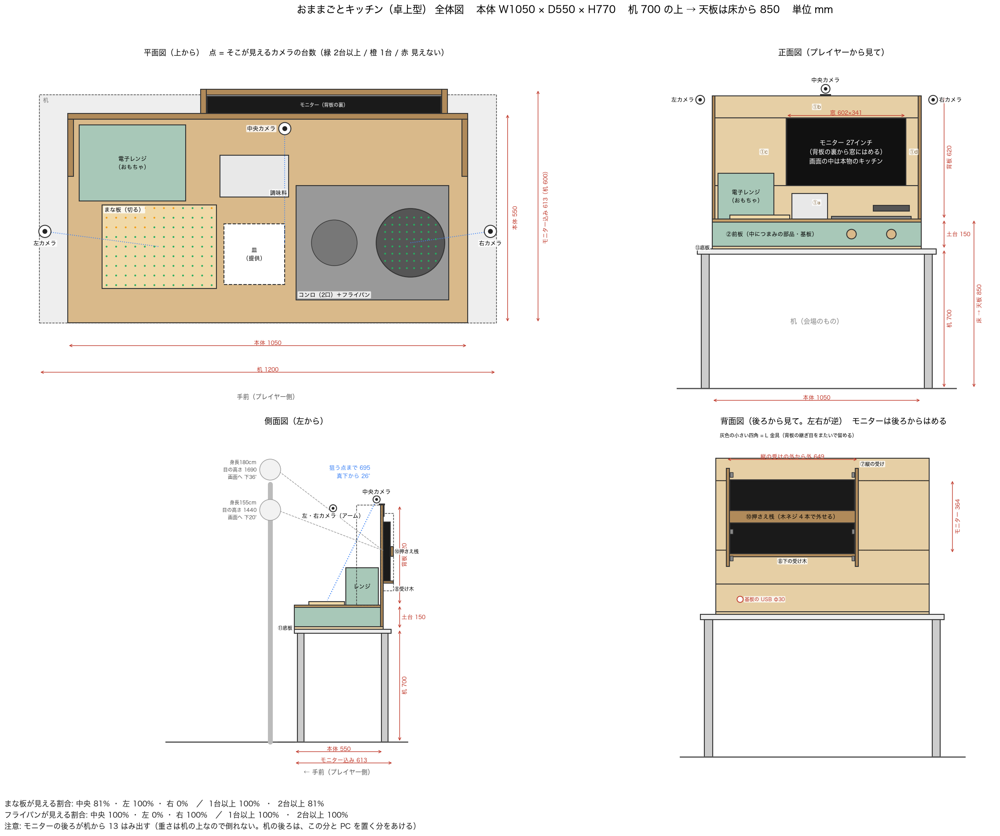
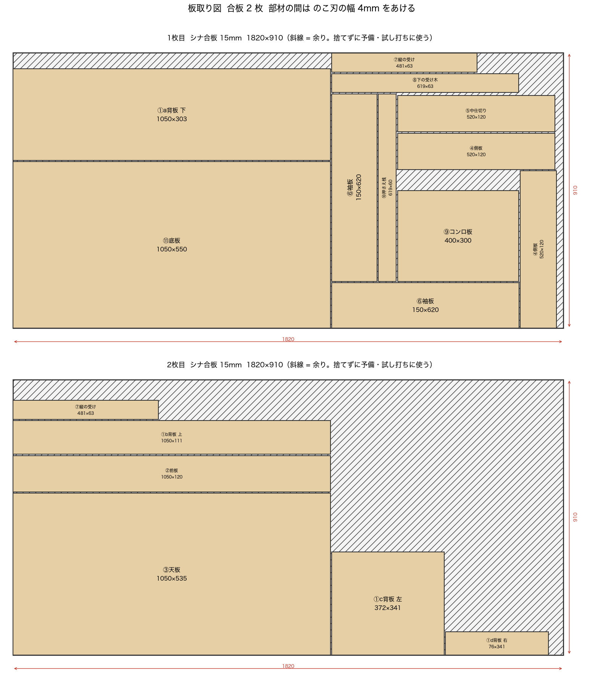
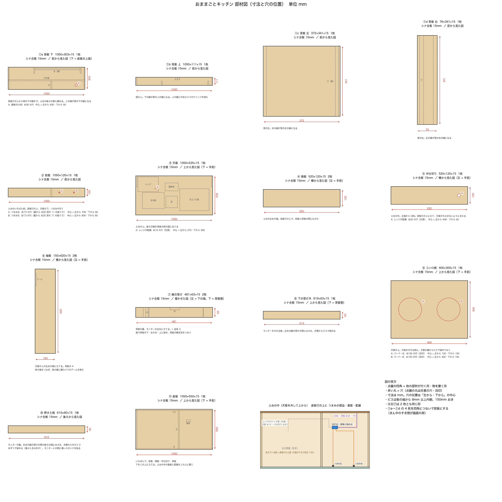

# おままごとキッチン 設計書 v1

2026年10月1日

キッチン台（机の上に置く卓上型）を作るための設計書。寸法・部材・穴あけ・組み立て・カメラの付け方をまとめる。何を作るかは [要件定義書](要件定義書_v1.md) を見る。

**組み立ての流れは 3D で見られる → [kitchen_3d.html](kitchen_3d.html)**（ブラウザで開く。インターネットにつながっている必要がある）。1 工程ずつ板が入ってくる様子を、好きな向きから回して見られる。板をタップすると寸法と付く所が出る。ビスや金具などの留め方は自分たちで決めてよく、この設計書の 5・6 章は参考。

図と、`auto` の印が付いた表の数字は `tools/kitchen_plan.py` が計算している。寸法を変えるときは 11 章を見る。

## 1. 決まっていること

| 項目 | 決定 |
| --- | --- |
| 形 | 机の上に置く卓上型 |
| 使う人 | 大人（18 歳〜）。天板は床から 850（普通のキッチンと同じ高さ） |
| 材料 | シナ合板 15mm。ホームセンターで寸法どおりに切ってもらう（まっすぐに切るだけで全部作れる） |
| 土台 | **底板⑪の上に**前板・側板・中仕切り・背板 下を立てた箱。中に基板と配線を入れる |
| 運び方 | 組んだまま、底板ごと下から持って運ぶ。モニターとカメラは外して運ぶ |
| モニター | 27 インチ。**背板の窓に後ろからはめる**。背板は窓のまわりの 4 枚（下・上・左・右）を四角につないで作る |
| コンロ | 作り付け（2 口）。つまみ 2 個を土台の前に付ける |
| 電子レンジ | 市販のおもちゃを天板に置く |
| カメラ | 中央 1 台（Anker PowerConf C200、画角 78°、背板の上の縁にクリップで挟む）＋左右 2 台（両サイドの関節アームの先） |
| PC | 本体の後ろに置き、モニター・カメラ 3 台・基板をつなぐ。線はすべて背板の後ろから出る。机の上に置く場所がないときは、机の後ろの床か台に置き、その分だけ机を壁から離す |

## 2. 全体図

<!-- auto:dims -->
| 項目 | 寸法（mm） |
| --- | --- |
| 本体（幅×奥行き×高さ） | 1050 × 550 × 770（机の上面から背板の上端まで） |
| モニターを含めた奥行き | 613（モニターと受けが背板の後ろに出る） |
| 天板の高さ | 机の上面から 150。床から 850（机 700 のとき） |
| 背板の上端 | 床から 1470 |
| 窓（画面の枠） | 左端から 372、天板から 168。大きさ 602 × 341 |
| モニター本体（背板の裏） | 左端から 366.5、天板から 150（本体 613×364×45） |
| 画面の中心 | 床から 1188 |
| 画面の上の端 | 背板の厚みで、身長 180cm の人からは上の約 5mm が隠れる |
| 土台の中 | 底板⑪の上から天板の下まで 高さ 120。右の部屋（基板・つまみの部品）は 幅 440 × 奥行き 520 |
| つまみ | 左端から 700・900、机の上面から 75（前板の高さの真ん中） |
| 中央カメラ | 左端から 570、手前から 510、天板から 655（背板の上の縁にクリップ。下に約 64° 向ける。画角 78°） |
| 左右カメラ | 手前から 240、天板から 600（袖板の前の縁にアーム、画角 58°） |
| 重さ（目安） | 約 20 kg（モニター・カメラ・金物を除く） |

**注意（tools/kitchen_plan.py のチェック）**

- モニターの後ろが机から 13 はみ出す（重さは机の上なので倒れない。机の後ろは、この分と PC を置く分をあける）
<!-- /auto:dims -->

画面のいちばん上は、背の高い人から見ると背板の厚みで少し隠れる（上の表の「画面の上の端」）。**Unity の UI は画面の上の端から 2cm 以上離して置く。**

## 3. 部材表と板取り

ホームセンターのカットサービスには、この表と板取り図を持っていく。

<!-- auto:cutlist -->
| 番号 | 名前 | 長さ × 幅 × 厚さ | 枚数 | 付く所 |
| --- | --- | --- | --- | --- |
| ①a | 背板 下 | 1050 × 303 × 15 | 1 | 底板⑪の上から窓の下の縁まで。土台の後ろの板も兼ねる。上の縁が窓の下の縁になる |
| ①b | 背板 上 | 1050 × 111 × 15 | 1 | 窓の上。下の縁が窓の上の縁になる。上の縁に中央カメラのクリップを挟む |
| ①c | 背板 左 | 372 × 341 × 15 | 1 | 窓の左。右の縁が窓の左の縁になる |
| ①d | 背板 右 | 76 × 341 × 15 | 1 | 窓の右。左の縁が窓の右の縁になる |
| ② | 前板 | 1050 × 120 × 15 | 1 | 土台のいちばん前。底板⑪の上、天板の下。つまみが付く |
| ③ | 天板 | 1050 × 535 × 15 | 1 | 土台の上。後ろの縁を背板の前の面に当てる |
| ④ | 側板 | 520 × 120 × 15 | 2 | 土台の左右の端。底板⑪の上で、前板と背板の間にはさむ |
| ⑤ | 中仕切り | 520 × 120 × 15 | 1 | 土台の中。左端から 580。底板⑪の上に立て、天板がたわまないように支える |
| ⑥ | 袖板 | 150 × 620 × 15 | 2 | 天板の上の左右の端に立てる。背板の 4 枚の端をつなぎ、前の縁に横カメラのアームを挟む |
| ⑦ | 縦の受け | 481 × 63 × 15 | 2 | 背板の裏、モニターの左右に立てる。L 金具 3 個で背板の下・左か右・上に留め、背板の継ぎ目をつなぐ |
| ⑧ | 下の受け木 | 619 × 63 × 15 | 1 | モニターをのせる板。左右の縦の受けの間にはさみ、外側からビスで留める |
| ⑨ | コンロ板 | 400 × 300 × 15 | 1 | 天板の上。天板をのせる前に、天板の裏からビスで留めておく |
| ⑩ | 押さえ桟 | 619 × 60 × 15 | 1 | モニターの裏。左右の縦の受けの間の後ろの端にはさみ、外側から木ネジ 2 本ずつで留める（運ぶときは外す）。モニターとの間に薄いスポンジを貼る |
| ⑪ | 底板 | 1050 × 550 × 15 | 1 | いちばん下。前板・側板・中仕切り・背板 下をこの上に立てる。土台の中の基板と配線もこの上に置く |

- すべて シナ合板 15mm。2 枚（910×1820）から 17 枚を取る。並べ方は下の板取り図。カットはおよそ 34 回
<!-- /auto:cutlist -->

カットを頼むときの注意

- 寸法は「長さ × 幅」。板取り図を印刷して一緒に渡すと話が早い
- 部材の間には、のこ刃の幅（4mm）をあけてある。切ってもらったら長さを測って確かめる
- 細い板（①d 背板 右・⑦ 縦の受け・⑧ 下の受け木・⑩ 押さえ桟）は、店によっては切ってもらえない。先に聞く
- **窓のまわりの 4 枚（①a〜①d）は寸法がずれると窓がゆがむ**。特に ①c と ①d の高さ（窓の高さ）は同じにしてもらう
- 余った板は捨てない。下穴やビスの試し打ち、予備に使う

## 4. 部材ごとの加工

穴は、切ってもらった後に自分たちで開ける。部材図の A・B… が穴の記号。

| 穴・加工 | 大きさ | 工具 | 注意 |
| --- | --- | --- | --- |
| つまみ（②前板 A・B） | 裏から Φ25・深さ 11 の座ぐり → Φ7.5 の貫通 | ボアビット Φ25、ドリル Φ7.5 | 表に 4mm だけ残す。つまみの部品のネジ部分を裏から通し、表からナットで締める |
| 基板の USB（①a 背板 下 A） | Φ30 | ホールソー Φ30 | 土台の右の部屋の後ろ |
| レンジの配線（③天板 A・⑤中仕切り A） | Φ15・Φ20 | ドリル | 任意。電子レンジにスイッチを付けるときだけ |
| 窓の縁（①a の上の縁・①b の下の縁・①c の右の縁・①d の左の縁） | — | サンドペーパー | 画面の枠として見える。#240 まで磨き、角を軽く丸める |
| ビスの下穴 | Φ3、皿取り | ドリル、皿取り錐 | 板の端から 8mm 以上内側に 150mm おき。合板の切り口（木口）に打つときは必ず下穴を開ける（割れ防止） |

モニターは背板の裏にあるので、モニターのケーブル用の穴はいらない。

## 5. 買うもの

値段はおよその目安（私の記憶による 2026 年ごろの相場）。買う前に店で確かめる。

| 品名 | 数 | 値段の目安 | 使う所 |
| --- | --- | --- | --- |
| シナ合板 15mm 910×1820 | 2 枚 | 1 枚 5,000〜8,000 円 | 本体 |
| カット代 | 3 章の回数 | 1 回 30〜50 円 | ホームセンター |
| スリムビス 3.3×32 | 1 箱（約 100 本） | 500 円 | 板どうし（細いビスの方が合板の木口が割れにくい） |
| 木ネジ 3.5×16 | 約 50 本 | 300 円 | L 金具 |
| 木ネジ 3.5×40 | 4 本 | 100 円 | ⑩ 押さえ桟（運ぶときに外す） |
| 木工用ボンド | 1 本 | 400 円 | 板どうし（ビスと一緒に使う） |
| L 金具 30〜40mm | 8 個 | 800 円 | ⑦ 縦の受け 6 個、⑥ 袖板の内側の下 2 個 |
| 薄いスポンジ（両面テープ付き、厚さ 3mm 前後） | 1 | 200 円 | ⑩ 押さえ桟とモニターの間 |
| クランプ式アーム | 2 | 300〜2,900 円 | 左右のカメラ |
| つまみ（直径 40〜50） | 2 | 1 個 200〜500 円 | コンロ |
| つまみの部品（7 章） | 2 | 1 個 100〜300 円 | コンロ |
| ESP32 開発ボード | 1 | 1,500 円 | 土台の中 |
| 滑り止めシート | 1 | 300 円 | 底板⑪と机の間 |
| 水性塗料（ミントグリーン）・水性ニス | 各 1 | 合わせて 2,000 円 | 仕上げ |
| サンドペーパー #180・#240 | 各数枚 | 300 円 | 仕上げ |

持っていなければ借りる工具: 電動ドリルドライバー、ボアビット Φ25、ホールソー Φ30、皿取り錐、クランプ（仮止め用）、さしがね（直角を測る）、メジャー。

## 6. 組み立ての順番

1. **ヤスリがけと塗装**: 全部の板の表面と角を #180 → #240 で磨く。見える面は組む前に塗る（ボンドを付ける面は塗らない）。前板②はミントグリーン、ほかは水性ニス
2. **穴あけ**: 4 章の穴を開ける（組んだ後だとドリルが入らない所がある）
3. **背板を四角につなぐ**: 平らな床に、背板の 4 枚（①a〜①d）を**表を下にして**窓の形に並べる。窓の大きさ（2 章の表）を測って合わせ、窓の対角線の長さが 2 本とも同じになるようにする（同じなら直角）。縦の受け⑦ 2 本を窓の左右に立て、L 金具 3 個ずつで ①a・①c か ①d・①b に留める（継ぎ目をまたぐように）
4. **土台の枠**: 前板②の裏に側板④ 2 枚と中仕切り⑤を立て、前板の表からビス＋ボンドで留める。ビスの頭は木工パテで埋めて塗る。この枠を底板⑪にのせ、底板の下からビスで留める（ボンドは付けない。あとで底板を外して中を直せる）
5. **背板を付ける**: 3 でつないだ背板を底板⑪の後ろの端に立て、背板の後ろから側板④と中仕切り⑤へ、底板の下から背板 下①a へビス
6. **つまみと基板**: つまみの部品を前板の裏から差し込み、表からナットで締めて、つまみを付ける。基板（ESP32）を底板の右の部屋に留め、7 章のとおりに配線する。**天板をのせると中に手が入らないので、配線はここで済ませる**
7. **天板とコンロ板**: コンロ板⑨を天板③の上の位置（部材図の点線）に合わせ、天板の裏からビスで留める。バーナーの円（直径 120）はシールか塗装で描く。天板を土台にのせ、上から前板・側板・中仕切りへビス。後ろの縁は、背板の後ろから天板の木口へビス。見える所のビスの頭はパテで埋める
8. **袖板**: 袖板⑥ 2 枚を天板の上の左右の端に立て、背板の後ろから 4 枚それぞれにビス（背板の端をつなぐ）。内側の下の角を L 金具で天板に留める
9. **下の受け木**: 下の受け木⑧を縦の受けの間にはさみ、縦の受けの外側からビス 2 本ずつ
10. **モニターをはめる**: 後ろから、モニターを下の受け木⑧にのせ、画面を窓に押し当てる。表から見て画面が窓の真ん中に来ているか確かめる
11. **押さえ桟**: モニターの背面にスポンジを貼り、押さえ桟⑩を縦の受けの間の後ろの端にはさんで、外側から木ネジ 2 本ずつ（3.5×40）で留める
12. **中央のカメラ**: 中央カメラに付いているクリップを背板 上①b の上の縁に挟み、下に傾けて、まな板とコンロの真ん中を向ける
13. **左右のカメラ**: 両サイドの袖板⑥の前の縁にクランプ式の関節アームを挟み、先にカメラを付ける。関節を曲げて、左はまな板、右はフライパンに向ける
14. **ケーブル**: モニターとカメラのケーブルは背板の後ろでまとめて、本体の後ろの PC へ。基板の USB も背板 下①a の Φ30 から同じ PC へ
15. **机に置く**: 滑り止めシートを敷き、キッチンの前の縁を机の前の縁にそろえる

## 7. 土台の中（電装）

土台の右の部屋（中仕切り⑤より右）の底板⑪の上に、つまみの部品と基板を入れる。部材図の「土台の中」を見る。中の高さは 2 章の表の「土台の中」。

- **つまみの部品**: 要件定義書（5.4）ではロータリーエンコーダ。つまみの向きを目盛り（切・弱・中・強）とそろえたいなら、可変抵抗（B10kΩ）か 4 段のロータリースイッチの方が合う。どれを選んでも前板の穴は同じ（ネジ部分が M7〜M9 のもの）
- **基板**: ESP32 開発ボードを底板⑪の右の部屋にスペーサーで留める（部材図の ⑪ の「基板」の所。左のつまみの真後ろ）
- **配線**: つまみの部品 → 基板。基板の USB → 背板 下①a の Φ30 → 本体の後ろの PC（電源もここから取る）。線は底板の上をはわせる
- **電子レンジ（任意）**: おもちゃの扉に磁石、天板側にリードスイッチを付ける。線は天板の Φ15 → 左の部屋 → 中仕切りの Φ20 → 基板
- **中を直すとき**: 天板をのせた後は、土台の中に手が入らない。モニターとカメラを外し、キッチンを背板を下にして寝かせて、底板⑪のビスを外す。基板への書き込みは USB（背板の Φ30）からできるので、ふだんは開けなくてよい
- ピンの割り当てはファームの担当が決めて `device/README.md` に書く

## 8. カメラの取り付けと見え方

| カメラ | 取り付け方 |
| --- | --- |
| 中央（Anker C200） | カメラに付いているクリップで背板 上①b の上の縁に挟み、下に傾ける（角度は 2 章の表）。AnkerWork で画角を 78° にし、オートフォーカスと自動露出を切る |
| 左・右（Brio 100 など） | 両サイドの袖板⑥の前の縁にクランプ式の関節アームを挟み、アームの先にカメラを付ける。カメラは本体の横から約 60 外に出し、左はまな板、右はフライパンに向ける |

中央カメラはクリップで背板の上の縁に挟むので、レンズは背板の前の面より約 25mm 前に来る。木の台で 95mm 前に出すと、2 台以上から見えるまな板が 81% から 89% に増えるが、部品を増やさないことを優先した。

<!-- auto:camera -->
| カメラ | 位置（左端から・手前から・天板から） | 画角 | 狙う所 |
| --- | --- | --- | --- |
| 中央 | 570 ・ 510 ・ 655 | 78° | まな板とフライパンの真ん中 |
| 左 | -60 ・ 240 ・ 600 | 58° | まな板 |
| 右 | 1110 ・ 240 ・ 600 | 58° | フライパン |

計算の結果（手で隠れる分は含まない）:

- まな板が見える割合: 中央 81% ・ 左 100% ・ 右 0%   ／  1台以上 100%  ・  2台以上 81%
- フライパンが見える割合: 中央 100% ・ 左 0% ・ 右 100%   ／  1台以上 100%  ・  2台以上 100%
<!-- /auto:camera -->

まな板の奥の左側の一部は、電子レンジの陰になって中央カメラからは見えず、左カメラ 1 台だけで見ている（全体図の橙の点）。気になるときは電子レンジを奥か左に寄せる。

## 9. 運び方

- 組んだまま運ぶ。運ぶ前に、押さえ桟⑩の木ネジ 4 本を外してモニターを後ろに抜き、カメラ 3 台を外す
- 2 人で、底板⑪の前と後ろを下から持つ。袖板⑥・縦の受け⑦はつかまない（折れる）
- 寝かせるときは背板を下にする（前を下にすると、袖板に重さがかかる）
- 大きさは 幅 1050 × 奥行き 550 × 高さ 770（モニターを外した状態）。重さは 2 章の表

## 10. 実物を測ってから決めること

**モニターを買って実測するまで、背板の ①b ①c ①d・縦の受け⑦・下の受け木⑧・押さえ桟⑩ は切らない**（窓の大きさと位置がモニターで決まる）。ほかの板（①a ② ③ ④ ⑤ ⑥ ⑨ ⑪）は今の寸法で切ってよい。

| 測るもの | 測る所 | `P` の名前（tools/kitchen_plan.py） |
| --- | --- | --- |
| 展示の机 | 幅・奥行き・高さ | desk_w, desk_d, desk_h |
| PC を置く所 | 机の上に余りがあるか。なければ机の後ろの床か台に置けるか、壁までの距離 | 図には入れていない |
| モニター | 本体の幅・高さ、いちばん厚い所の厚さ、表示部分（映る所）の幅・高さ、下の縁の太さ | mon_w, mon_h, mon_t, view_w, view_h, bezel_bottom |
| まな板（おもちゃ） | 幅・奥行き・厚さ | board_w, board_d, board_t |
| フライパン（おもちゃ） | 直径、コンロにのせたときの底の高さ | pan_r（半径）, pan_z |
| 電子レンジ（おもちゃ） | 幅・奥行き・高さ | mw_w, mw_d, mw_h |
| 中央カメラ | クリップで下に何度まで傾けられるか（必要な角度は 2 章の表） | 足りなければ小さな自由雲台を足す |

## 11. 寸法を変えるとき

1. `tools/kitchen_plan.py` の先頭にある `P` の数字を書き換える
2. `python tools/kitchen_plan.py` を実行する
3. 図（`docs/img/kitchen_*.png`）と、この設計書の 2・3・8 章の表が描き直される。板取り図も自動で並べ直す。寸法が食い違うと「注意」が出る（机からはみ出す、画面がレンジに隠れる、細すぎて切ってもらえない板がある、カメラから見えない所がある など）
