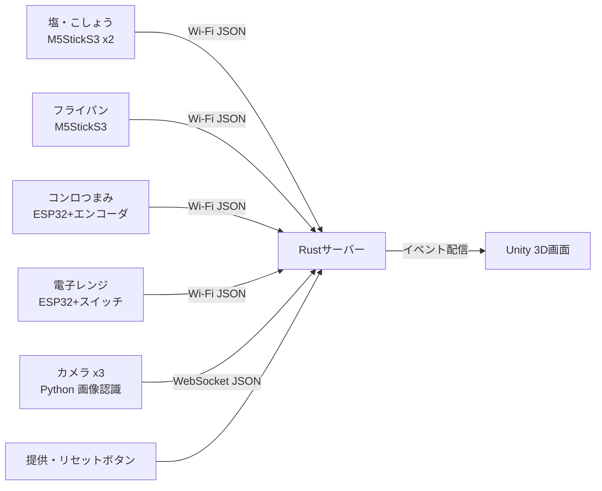
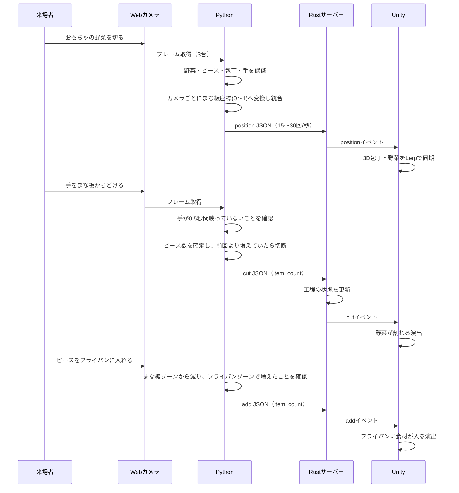

# リアルおままごと調理システム 要件定義書 v1

2026年9月25日

## 0. 文書の位置づけ

本書は「展示までに必ず動かすもの」を定める約束の文書である。「次世代おままごとキッチン 企画まとめ」は目指す姿を示すビジョン文書であり、二つが食い違ったときは本書が優先する。

本書に無い機能は作らない。作りたくなったら、先に本書を改訂してから着手する。

| 用語 | 意味 |
| --- | --- |
| 必須 | 展示日に動いていないと展示が成立しないもの |
| 目標 | 期限内に実装を目指すが、間に合わなくても展示は成立するもの |
| 余裕があれば | 必須・目標が終わってから着手するもの |
| ピース | おもちゃの野菜が分かれた一片。切る前は1ピース |
| ゾーン | まな板・フライパン・皿など、カメラ画像上で区切った領域 |
| キャリブレーション | カメラ画像の4隅をまな板の座標（0〜1）に対応づける作業 |
| 仮決定 | 変更の申し出がなければ確定として扱う決定 |

## 1. 概要と目的

現実のおもちゃの調理器具を操作すると、画面の3Dキッチンが同期して調理が進む「リアルおままごと」を作る。進級制作展で来場者が実際に触って遊べる展示を目標とする。

- 制作期間：2026年10月〜2027年3月
- 制作人数：6人
- 展示日：＿＿＿＿（要記入。全マイルストーンの基準になる）
- 開発の凍結日：展示日の14日前（以降はバグ修正と調整のみ）

## 2. 展示で成立させる体験

体験は「切る → 入れる → 味付け → 加熱 → 食べさせる」の一本道とし、来場者1人あたり2〜3分で完結させる。

### 2.1 必須（展示に必要）

| 体験 | 判定に使うもの |
| --- | --- |
| おもちゃの野菜を包丁で切ると、画面の野菜が切れる | カメラ（ピース数） |
| 切った野菜をフライパンに入れると、画面のフライパンに入る | カメラ（ゾーン移動） |
| 調味料容器を振ると、画面の鍋に調味料が入り、量に応じて味が変わる | センサー（M5） |
| コンロのつまみを回すと火がつき、調理が始まる | センサー（ロータリーエンコーダ） |
| 完成した料理をキャラクターに出すと、食べて評価する | ボタン |
| 包丁・野菜・フライパンの位置がまな板平面上で画面と同期する | カメラ |
| 来場者が入れ替わるとき、ボタン一つで初期状態に戻る | サーバー |

### 2.2 目標

| 体験 | 備考 |
| --- | --- |
| 包丁を振り下ろした瞬間に「カッ」の即時演出が出る | ピース数での確定とは別に、演出だけ先に出す |
| 3台のカメラで死角を減らし、手で隠れても位置同期が途切れにくい | 1台で成立させてから追加する（6.2） |
| フライパンを傾ける・振ると画面のフライパンも動く | フライパンにM5を付ける |
| おもちゃの電子レンジに食材を入れて操作すると加熱演出が出る | 扉スイッチ＋ボタン |
| 3DGSで撮影した実物のステージを背景に使う | 静止画フォールバックを必須にする（6.4） |

### 2.3 余裕があれば

| 体験 | 備考 |
| --- | --- |
| モニターをキッチン台に埋め込む | 先にVESAアーム＋前面枠で同じ見た目にする |
| 食材を持ち上げた高さ・空中の位置を画面に反映する | 2台以上のカメラでの三角測量が必要 |
| 認識する野菜を4種類以上に増やす | 仮決定は3種類（12章） |

### 2.4 仮決定のレシピ

採点の基準になるため、レシピを1つ固定する。

| 工程 | 来場者の操作 | 正解の条件 |
| --- | --- | --- |
| 1. 切る | にんじんを包丁で切る | ピース数が2以上 |
| 2. 入れる | ピースをフライパンに入れる | フライパンゾーンにピースが1個以上 |
| 3. 味付け | 塩・こしょうを振る | 塩 2〜4g、こしょう 0.5〜1.5g 相当 |
| 4. 加熱 | つまみを「中」に回して10秒待つ | つまみ位置と経過時間 |
| 5. 提供 | 提供ボタンを押す | 工程1〜4の達成度から採点 |

## 3. システム構成

入力（センサーデバイス、カメラ）をすべてRustサーバーに集め、サーバーがゲームロジックを処理してUnityにイベントを配信する。サーバー・Python・Unityは展示用ノートPC 1台で動かす。



| 役割 | 担当 | やること |
| --- | --- | --- |
| センサーデバイス | ESP32系（M5StickS3 / ESP32ボード、Arduino C++） | 振り・傾き・回転・スイッチを検知し、共通形式のJSONを送る。全デバイスが同じファームウェアで動き、役割はサーバー側の設定で決まる |
| カメラ | Python（画像認識） | まな板周辺を3台で撮影し、学習済みモデルで野菜・ピース・包丁・フライパン・手を認識してJSONを送る |
| サーバー | Rust（axum + tokio） | 入力を受け、デバイスID→役割の変換、量の換算、鍋の状態管理、工程の進行、採点、リセット |
| 画面 | Unity（C#） | イベントを受けて3Dの演出を再生する。判断はしない |

サーバーにRustを採用する理由：長時間稼働の堅牢性（メモリ安全・低負荷）と担当者の学習目的。担当者：＿＿＿＿（要記入）。

## 4. 野菜・包丁のデータフロー

位置は毎フレーム送って同期し、「切った」は手がどいたときのピース数で確定する。振り下ろしの即時演出（目標）は確定とは独立に出す。



## 5. 機能要件

### 5.1 センサーデバイス（共通）

- デバイスIDはESP32のMACアドレスを使う。全デバイスが同じファームウェアで動き、役割（塩・こしょう・フライパン・つまみ・レンジ）はサーバーの設定ファイルで決める
- 起動したら自動でWi-Fiに接続し、mDNS（`omamagoto.local`）でサーバーを見つけて接続する。IPアドレスを焼き込まない
- 送信するJSONには時刻（ミリ秒）と連番を付ける。サーバーは連番の重複を捨てる
- 30秒ごとにバッテリー残量（%）を送る
- 接続が切れたら3秒間隔で再接続する。サーバーを再起動してもデバイスの再起動は不要
- 状態（接続中・未接続・バッテリー低下）をデバイスの画面かLEDで示す

### 5.2 調味料デバイス（塩・こしょう）

- 振りを検知し、「1振り」ごとに強さ（0〜1）と傾き（度）を付けて送る
- 持ち運びの揺れと振る動作を区別する（傾き45度以上、かつ短周期の加速度の繰り返しを条件にする）
- しきい値はサーバー設定で調整できる

### 5.3 フライパン（目標）

- 傾き（度）と振りを送る。位置はカメラが担当する
- 傾きが30度以上でUnityに「傾け」の演出を出す

### 5.4 コンロつまみ

- ロータリーエンコーダで「切・弱・中・強」の4段階を送る
- 段階が変わったときだけ送る（連続送信しない）

### 5.5 電子レンジ（目標）

- 扉の開閉（リードスイッチ）とスタートボタンの状態を送る
- 扉が閉まった状態でスタートが押されたら「加熱開始」とする。加熱時間はサーバーが管理する

### 5.6 カメラ：認識

- マーカーは一切使わない。おもちゃの写真を学習させた検出モデル（YOLO系）で認識する
- 学習対象は「野菜の種類（仮決定3種類）」「切った後のピース」「包丁」「フライパン」。手は手検出ライブラリで別に検出する
- 学習写真は本番と同じカメラ・同じ配置・会場に近い照明で撮る。1対象につき100枚以上、角度・距離・持ち方を変える。何も置いていない台と手だけの写真も学習に混ぜる
- 「切った」は切る動作ではなく、手が0.5秒間映っていない状態で数えたピース数が、前回の確定値より増えたことで判定する
- 「フライパンに入れた」は、まな板ゾーンのピース数が減り、フライパンゾーンのピース数が増えたことで判定する
- 「振り下ろし」（目標）は、包丁の刃先が野菜の枠の上から中へ0.5秒以内に入ったことで判定し、演出用イベントとして送る。工程の判定には使わない
- 野菜・ピース・包丁・フライパンの位置をまな板の範囲で0〜1に正規化して送る。包丁は刃先と柄尻の2点、それ以外は枠の中心を送る
- 位置の送信は15〜30回/秒に間引く。見失ったら `visible: false` を1回送る
- 認識結果を重ねた映像を運営用の別ウィンドウに表示する（展示中の監視とデバッグ用）

### 5.7 カメラ：3台構成

3台を使うが、1台で全判定が成立する設計にし、台数は段階的に増やす。

| 段階 | 台数 | 内容 | 完了条件 |
| --- | --- | --- | --- |
| A | 1台（中央） | モニター上部からまな板をほぼ真上（20〜30度傾け）から撮影。全判定を成立させる | 2.1の体験が1台で動く |
| B | 2台（＋左） | 高い位置から別角度で撮影し、まな板平面上で統合する | 手で隠れたときの位置同期の途切れが半減する |
| C | 3台（＋右） | 同上。3台の統合で死角をさらに減らす | 8.3の受け入れ基準を満たす |

- 各カメラを独立にキャリブレーションし、まな板座標（0〜1）に変換してから統合する
- 統合ルール（まな板平面上）：同じ種類の検出が、まな板座標で幅の5%以内にあれば同一物とみなし、確信度の高い方を採用する。ピース数は「手が映っていないカメラ」の最大値を採用する
- 同期：各フレームに取得時刻を付け、時刻差100ミリ秒以内のフレームだけ統合する
- 3台とも720p・30fps・MJPEGで取り込む。別々のUSBポート（可能ならコントローラ）に接続し、同時取り込みできることを実機で確認する
- 処理速度：3台同時で各15fps以上。足りなければ中央30fps・左右10fpsにする
- 高さ推定（余裕があれば）：2台以上で同じ物を見たときの三角測量で行う。チェスボードでカメラ間の位置関係を校正する
- 3台をモニター枠に横一列に並べると角度が似て死角が重なるため、左右はモニター枠より外側・高い位置に仮設して映りを確認してから位置を決める

### 5.8 カメラ：キャリブレーションとゾーン

- 起動時にカメラごとに4隅をクリックしてまな板座標に対応づける。設定は保存し、次回起動時はそのまま使う
- まな板・フライパン・皿のゾーンは同じ画面で矩形をドラッグして設定する
- キャリブレーションは会場設営時に必ずやり直す。所要時間は3台で10分以内
- 露出とホワイトバランスは固定する（8.1）。固定できない機種は使わない

### 5.9 サーバー

- デバイスとPythonからのWebSocket接続を受け付け、mDNSで `omamagoto.local` として名前を広告する
- 設定ファイル（TOML）でMACアドレス→役割を対応付ける。書き換えなしで役割を変えられる
- 振り回数×強さをグラムに換算する。係数は設定で調整できる
- 鍋の状態（何が何g入っているか、切った野菜の数、フライパンの中身、つまみの段階、工程の進み具合）を保持する
- 工程はレシピ（2.4）に沿って進む。順番が違う操作は受け付けるが、採点で減点する
- 提供ボタンを受けたら、レシピの正解条件との差から100点満点で採点し、コメント種別（`good`、`too_salty`、`undercooked` など）とともに送る
- リセット操作（ボタン、または運営用画面）を受け付け、鍋の状態を初期化する。手・包丁・フライパンが90秒間映らなければ自動でリセットする
- すべての受信JSONと送信イベントをファイルに記録する（展示後の分析とデバッグ用）
- 接続中のデバイスとバッテリー残量を運営用画面に表示する

### 5.10 画面（Unity）

- まな板・コンロ・電子レンジ・皿を現実のキッチンと同じ配置で置く
- 野菜・ピース・包丁・フライパン・調味料は3Dオブジェクトとして置き、位置イベントで現実の位置と合わせる。位置データはLerpで補間し、通信の揺れを見せない
- `visible: false` を受けた物は最後の位置に留め、3秒後にフェードアウトする
- イベントごとの演出（調味料が降る、野菜が割れる、フライパンに入る、火がつく、加熱）を再生する
- 提供後は料理をキャラクターの前に出し、評価結果に応じたリアクション（喜ぶ・普通・顔をしかめる の3種類以上）とコメントを表示する。食べるアニメーションは自作またはモーション素材を使う（Mixamoに無い）
- 背景：3DGS（XGRIDSで撮影）を目標とし、3DGSを描画した静止画または動画を背景にするフォールバックを必須とする。展示PCで3DGSが30fpsを維持できなければフォールバックを使う
- 接続が切れたら自動で再接続する。再接続中は画面に小さく表示する

## 6. データ形式

すべてJSON。入力側は「何が起きたか」だけを送り、サーバーが意味付けしてからUnityに流す。全メッセージに共通ヘッダを付ける。

### 6.1 共通ヘッダ

| 項目 | 型 | 意味 |
| --- | --- | --- |
| `device` | 文字列 | 送信元。デバイスはMACアドレス、カメラは `camera`、サーバーは `server` |
| `ts` | 整数 | 送信時刻（ミリ秒）。デバイスは起動からの経過、PCはUNIX時刻 |
| `seq` | 整数 | 送信元ごとの連番。重複は捨てる |
| `event` | 文字列 | 種類 |

### 6.2 デバイス → サーバー

```json
{ "device": "AA:BB:CC:DD:EE:FF", "ts": 120340, "seq": 41, "event": "shake", "intensity": 0.8, "tilt": 72 }
{ "device": "AA:BB:CC:DD:EE:FF", "ts": 120900, "seq": 42, "event": "tilt", "tilt": 35 }
{ "device": "11:22:33:44:55:66", "ts": 5000, "seq": 3, "event": "knob", "level": 2 }
{ "device": "77:88:99:AA:BB:CC", "ts": 8000, "seq": 9, "event": "switch", "name": "door", "on": true }
{ "device": "AA:BB:CC:DD:EE:FF", "ts": 150000, "seq": 43, "event": "battery", "percent": 63 }
```

- `intensity` は0〜1、`tilt` は度（水平が0）、`level` は0=切・1=弱・2=中・3=強
- 役割（塩・こしょう・フライパン・つまみ・レンジ）はサーバーの設定で `device` から決める

### 6.3 Python → サーバー

```json
{ "device": "camera", "ts": 1760000000123, "seq": 5001, "event": "position", "item": "knife", "tip": [0.31, 0.12], "grip": [0.55, 0.05], "visible": true, "cam": 0 }
{ "device": "camera", "ts": 1760000000123, "seq": 5002, "event": "position", "item": "carrot", "x": 0.42, "y": 0.50, "rot": 15, "visible": true, "cam": 0 }
{ "device": "camera", "ts": 1760000001000, "seq": 5010, "event": "position", "item": "knife", "visible": false }
{ "device": "camera", "ts": 1760000002000, "seq": 5020, "event": "cut", "item": "carrot", "count": 2 }
{ "device": "camera", "ts": 1760000003000, "seq": 5030, "event": "add", "item": "carrot", "zone": "pan", "count": 1 }
{ "device": "camera", "ts": 1760000001500, "seq": 5015, "event": "swing", "item": "knife" }
{ "device": "camera", "ts": 1760000004000, "seq": 5040, "event": "hand", "present": false }
```

- 座標はまな板の範囲で0〜1。`rot` は度。`cam` は主に採用したカメラ番号
- `cut` の `count` は手がどいたときに確定したピース数。増えたときだけ送る
- `add` はゾーンに入ったピース数の増分

### 6.4 サーバー → Unity

```json
{ "device": "server", "ts": 1760000000130, "seq": 900, "event": "position", "item": "knife", "tip": [0.31, 0.12], "grip": [0.55, 0.05], "visible": true }
{ "device": "server", "ts": 1760000002010, "seq": 901, "event": "cut", "item": "carrot", "count": 2 }
{ "device": "server", "ts": 1760000003010, "seq": 902, "event": "add", "item": "carrot", "zone": "pan", "count": 1 }
{ "device": "server", "ts": 1760000005000, "seq": 903, "event": "season", "item": "salt", "amount_g": 0.5, "total_g": 3.2 }
{ "device": "server", "ts": 1760000006000, "seq": 904, "event": "fire", "level": 2 }
{ "device": "server", "ts": 1760000006500, "seq": 905, "event": "swing", "item": "knife" }
{ "device": "server", "ts": 1760000030000, "seq": 906, "event": "serve", "score": 72, "comment": "too_salty" }
{ "device": "server", "ts": 1760000031000, "seq": 907, "event": "reset" }
{ "device": "server", "ts": 1760000031000, "seq": 908, "event": "status", "devices": [{ "role": "salt", "connected": true, "battery": 63 }] }
```

### 6.5 サーバー設定ファイル（例）

```toml
[roles]
"AA:BB:CC:DD:EE:FF" = "salt"
"AA:BB:CC:DD:EE:00" = "pepper"
"AA:BB:CC:DD:EE:11" = "pan"
"11:22:33:44:55:66" = "knob"
"77:88:99:AA:BB:CC" = "range"

[season]
grams_per_shake = { salt = 0.5, pepper = 0.2 }

[reset]
idle_seconds = 90
```

## 7. 非機能要件

| 項目 | 要件 |
| --- | --- |
| 遅延 | 振り・つまみ操作から画面反映まで0.2秒以内。位置同期は0.15秒以内。切断確定は手がどいてから1秒以内 |
| デバイスの電源 | 展示1日（8時間）を、昼休み1回の充電で通す。内蔵バッテリーの連続時間を実測し、足りなければ容器内にモバイルバッテリーを入れる |
| 通信 | スマホのテザリングで完結する。会場のWi-Fiに依存しない。予備にモバイルルーターを用意し、どちらでもSSIDとパスワードを同じにする |
| 復旧 | デバイス・Python・Unityは接続が切れても自動で再接続する。サーバーを再起動してもデバイスの再起動は不要。サーバー・Python・Unityが落ちたら監視スクリプトが10秒以内に再起動する |
| 連続稼働 | 展示中（1日8時間×2日）フリーズせずに動く。事前に8時間の連続稼働テストを1回以上行う |
| リセット | 来場者が入れ替わるたびに、ボタン一つで初期状態に戻せる。90秒間無操作なら自動で戻る |
| 展示用PC | メモリ16GB以上、NVIDIA GPU搭載のWindowsノート（3台のカメラ推論と3DGS表示のため）。外付けGPUは使わない。Unityはビルド済みの実行ファイルで動かす |
| 安全 | デバイスは容器に固定し、落としても壊れないようにする。リポバッテリーを露出させない。カメラアームは来場者が触れても倒れないよう台に固定する |
| プライバシー | カメラは手元だけを映す画角にし、映像は保存しない。展示に「手元をカメラで認識しています」と掲示する |

## 8. 受け入れ基準

展示日の14日前（開発凍結日）に、以下をすべて満たしていることを確認する。

### 8.1 カメラ

| 基準 | 測り方 |
| --- | --- |
| 露出・ホワイトバランスが固定できる | `tools/camera_check.py` を展示PCで実行し「OK」が出る |
| 野菜・包丁の検出率95%以上 | 会場に近い照明で3分間映し、検出できたフレームの割合 |
| 誤検出が10分に1回以下 | 何も置いていない状態と手だけの状態で10分間記録する |
| 切断判定の正答率90%以上 | 20回切って、正しくcutが出た回数 |
| 切断の誤判定が0回 | 切らずに手を出し入れする操作を20回行い、cutが出ない |
| キャリブレーションが3台で10分以内 | 設営リハーサルで計時 |

### 8.2 デバイス

| 基準 | 測り方 |
| --- | --- |
| 振りの誤検知が持ち上げ20回で1回以下 | 容器を持ち上げて置く操作を20回 |
| 振り10回で10±1回カウントされる | 3人が各10回振る |
| 再接続が10秒以内 | サーバーを再起動して計時 |

### 8.3 全体

| 基準 | 測り方 |
| --- | --- |
| 2.1の体験を初見の人が説明1分で最後まで遊べる | メンバー以外5人で試す |
| 8時間連続稼働でフリーズなし | ログで確認 |
| 遅延が7章の値以内 | 送信側の `ts` とUnity受信時刻の差をログから集計 |
| 3台統合で、手で隠れたときの位置途切れが1台のときの半分以下 | 同じ操作を1台と3台で記録して比較 |

## 9. 機材・費用

金額は2026年9月時点の概算。PCとテザリング用スマホは手持ちを使う前提。合計は約90,000円（モニターとキッチン台の材料を含む）。

| 機材 | 数量 | 単価（円） | 備考 |
| --- | --- | --- | --- |
| M5StickS3 | 4 | 約4,500 | 塩・こしょう・フライパン・予備 |
| ESP32開発ボード | 2 | 約1,500 | コンロつまみ・電子レンジ用 |
| ロータリーエンコーダ、リードスイッチ、押しボタン | 1式 | 約1,500 | つまみ・レンジ・提供/リセットボタン |
| おもちゃの調味料容器 | 3 | 約110 | 100均。本体が入るサイズ |
| おもちゃの野菜・包丁・まな板・フライパン | 1式 | 約1,500 | 100均。学習用に同じものを使う |
| Webカメラ Logicool Brio 100 | 3 | 約3,555 | 1台買って露出固定を確認してから残りを買う |
| カメラ用クランプアーム | 3 | 約2,000 | 机に挟むタイプ。100均スタンドは不可 |
| USB延長ケーブル・USBハブ（セルフパワー） | 1式 | 約3,000 | 3台同時取り込み用 |
| モニター 31.5インチ（I-O DATA LCD-DF321XDB など） | 1 | 約25,000〜30,000 | VESA対応。新品価格を要確認 |
| モニターアーム（VESA） | 1 | 約3,000 | 埋め込みの代わりに背面から立てる |
| キッチン台の材料（木材・塗料・金具） | 1式 | 約15,000 | 寸法確定後に見積もり直す |
| デスクライト | 1 | 約2,000 | まな板の照明を一定にする |
| XGRIDSスキャナー | 1 | 借用 | 3DGS撮影用。学校の機材 |
| モバイルバッテリー | 2 | 約2,000 | 展示中の充電用 |
| USB-Cケーブル | 4 | 約500 | |

## 10. 技術スタック

| 部分 | 言語・ツール | 主なライブラリ |
| --- | --- | --- |
| センサーデバイス | C++（Arduino IDE / PlatformIO） | M5Unified、WiFi、ESPmDNS、WebSocketsClient、ArduinoJson |
| カメラ | Python 3.12 | ultralytics（YOLO 学習・推論）、OpenCV（撮影・キャリブレーション）、MediaPipe Hands（手検出）、websockets |
| サーバー | Rust | axum、tokio、tokio-tungstenite、serde_json、mdns-sd、toml |
| 画面 | Unity 2022 LTS（C#） | NativeWebSocket、Mixamo（キャラクター）、UnityGaussianSplatting（3DGS表示） |
| 運用 | PowerShell / Python | 起動・監視・再起動スクリプト、ログ収集 |

## 11. リスクと対策

| リスク | 起きやすさ | 対策 |
| --- | --- | --- |
| 画像認識の精度が会場の照明で落ちる | 高 | 露出・WBを固定する。デスクライトで照明を支配する。会場に近い照明で学習写真を撮り直す |
| 手で野菜が隠れて認識が途切れる | 高 | 切断はピース数で判定する。位置は最後の値を保持しフェードする。3台統合で死角を減らす |
| 3台の統合処理が間に合わない・複雑になる | 高 | 1台で全判定を成立させてから追加する。統合はまな板平面上に限定し、高さ推定は余裕があればに回す |
| 3DGSが展示PCで重い・表示できない | 中 | 静止画フォールバックを必須にし、展示PCが決まり次第動作確認する |
| デバイスのバッテリーが持たない | 高 | 早めに実測する。足りなければ容器内にモバイルバッテリーを入れる |
| 会場でサーバーのIPが変わってデバイスが繋がらない | 高 | mDNSで探索する。テザリングと予備ルーターのSSIDを同じにする |
| 会場でテザリングが不安定 | 中 | モバイルルーターを予備に持つ。BLE版ファームウェアは余裕があれば |
| 振りの誤検知（持ち上げただけで入る） | 中 | 傾きと加速度の繰り返しを条件にする。しきい値はサーバー設定で調整 |
| 来場者が入れ替わって状態が残る | 高 | リセットボタンを必須にする。90秒無操作で自動リセット |
| キッチン台の製作が遅れて統合テストができない | 高 | 寸法を早めに凍結する。簡易台で開発し、簡易台のままでも展示できる状態を保つ |
| 磁石式の野菜が切ってもくっついたままでピース数が増えない | 中 | 実物で確認する。増えない場合は「ピース間の隙間」を判定に加えるか、おもちゃを替える |
| 食べるアニメーションの制作が重い | 中 | 3種類のリアクションに絞る。モーション素材の購入を検討 |
| メンバーの担当が偏って結合が遅れる | 中 | 12章の担当表と月次マイルストーンで管理する |

## 12. 決定事項と未決事項

### 12.1 決定事項（2026年9月25日）

| 項目 | 決定 |
| --- | --- |
| カメラ台数 | 3台。ただし1台で全判定が成立する設計にし、段階的に追加する |
| サーバー言語 | Rust |
| マーカー | 一切使わない |
| 切断の判定 | 手がどいたときのピース数の増加。振り下ろしは演出用のみ |
| カメラの向き | 中央はほぼ真上（20〜30度傾け）。左右は高い位置から別角度 |
| モニター | VESAアームで立てて前面枠で囲う。埋め込みは余裕があれば |
| デバイス基板 | ESP32系に統一し、共通JSON形式で送る |
| 学習方式 | 自前の写真でYOLOを追加学習する（学習パイプラインは作成済み） |

### 12.2 未決事項

| 項目 | 決め方 |
| --- | --- |
| 展示日 | 学校の日程を確認して1章に記入 |
| レシピと採点基準（2.4の仮決定） | 仮決定のまま試作して遊び、変更点があれば改訂 |
| 野菜の種類（仮決定：にんじん・きゅうり・たまねぎ の3種類） | 100均で入手できる磁石式のもので決める |
| 展示PCの機種 | NVIDIA GPU搭載Windowsノートを確保。3DGSの動作確認をして確定 |
| Webカメラの機種 | Brio 100を1台買い、露出固定と取り付けを確認して確定 |
| デバイスの電源方式 | 内蔵バッテリーの連続時間を実測して決める |
| キッチン台の寸法 | モニター・電子レンジ・カメラアームの寸法を集めて凍結 |
| 3DGS採用の可否 | 展示PCで30fps出るかで決める。出なければフォールバック |

## 13. スケジュールと体制

### 13.1 マイルストーン

| 時期 | 到達点 | 確認方法 |
| --- | --- | --- |
| 10月末 | 各入力が単体で動く：M5の振り検知、カメラ1台での野菜・包丁認識と切断判定、つまみ、Unityで3Dの仮キッチン表示。簡易台がある | 各担当がデモ |
| 11月末 | サーバー経由で結合し、2.1の体験が簡易台で通しで遊べる（演出は仮）。カメラ2台目の統合。キッチン台の寸法凍結 | メンバー全員で通しプレイ |
| 12月末 | キッチン台の製作完了。カメラ3台目。演出とキャラクターのリアクション。電子レンジ・フライパンの傾き | 初見の人にプレイしてもらう |
| 1月末 | 会場に近い照明で学習写真を撮り直し、再学習。8時間連続稼働テスト。運営用画面 | 8章の受け入れ基準を計測 |
| 展示14日前 | 開発凍結。バグ修正と調整のみ | 8章をすべて満たす |
| 展示前日 | 設営、キャリブレーション、通しリハーサル | 設営手順書どおりに10分以内 |

### 13.2 担当

| 担当 | 人数 | 主な仕事 | 名前 |
| --- | --- | --- | --- |
| センサーデバイス | 1 | ファームウェア、容器への組み込み、電源 | ＿＿＿＿ |
| カメラ・画像認識 | 2 | 学習データ、モデル、キャリブレーション、3台統合 | ＿＿＿＿ |
| サーバー | 1 | Rustサーバー、設定、ログ、運営用画面 | ＿＿＿＿ |
| Unity | 1 | 3Dキッチン、演出、キャラクター、3DGS | ＿＿＿＿ |
| キッチン台・展示 | 1 | 台の設計と製作、モニター・カメラの固定、設営手順書、展示の掲示物 | ＿＿＿＿ |

- 週1回、全員で通しプレイをして進捗を確認する
- 各担当は自分の部分を単体で動かせる状態を常に保つ（他の担当を待たない）
